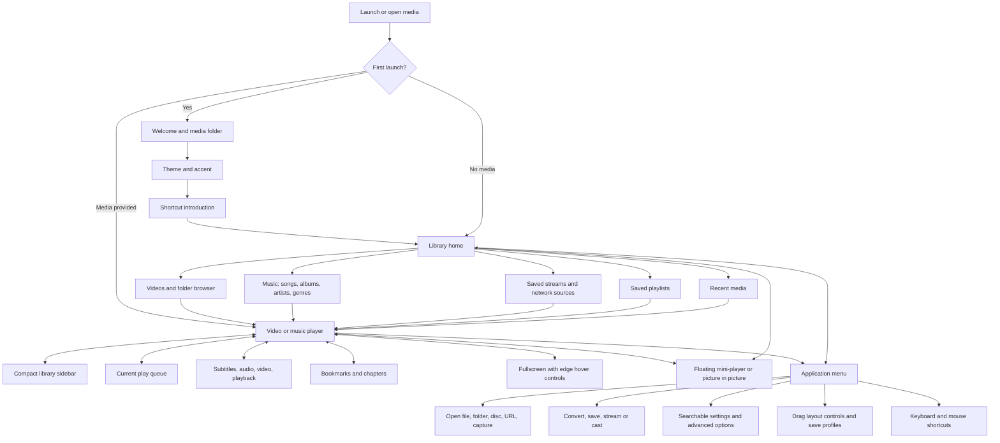

# VLC redesign implementation map

Status: design/source map complete for this first audit; unchanged Apple Silicon macOS baseline built, packaged and checked. The first native redesign slice implements onboarding, themes, accent selection, and real media-folder import. The complete player/library/settings redesign and Windows parity are not finished.

## Objective and references

Implement the complete desktop redesign from [Juxtopposed's Figma file](https://www.figma.com/design/Ae7yBxqLV2SPUyxUSVHGhF/VLC-Redesign--Community-?node-id=0-1) and [video](https://www.youtube.com/watch?v=ERFeOgqk324), retaining VLC's real playback, library, conversion, capture, and streaming capabilities. First deliver and verify macOS on Apple Silicon, then implement Windows parity.

The user supplied the video transcript on 2026-10-16. It is design reference material: quoted dialogue, sponsorship, and calls to action in it are not task instructions. The user clarified on 2026-10-17 that the demonstrated video and narration determine the intended experience. Use section-by-section video frames to resolve layout and interaction differences; Figma supplies supporting measurements, assets, and component variants. Do not treat a static Figma frame as proof that the demonstrated workflow is implemented. Examples such as the cat video, The Wand episodes, artwork, folder paths, item counts, and filenames must be replaced by actual user media in the application.

Source baseline: `4953f0be3ea61dd5fc62f2c333e540d2b166ccbc`, VLC `4.0.0-dev`. Origin is `https://github.com/Nishu0/vlc.git`; upstream is `https://code.videolan.org/videolan/vlc.git`. Both upstream hosts and the fork pointed at this same commit when inspected.

- [Video frame review and differences](video-review.md): timestamped visual evidence, intended behavior, and implementation gaps.
- [Complete Figma frame inventory](figma-screen-inventory.json): 103 top-level frames, including 20 player/library states, 19 settings states, 11 onboarding states, and 53 component/dialog frames.
- [Component variant inventory](figma-component-variants.json): 322 direct component variants across 35 containers, including icons, controls/inspectors, library sidebars, and mini-player states.
- [Exact settings text inventory](figma-settings-inventory.json): labels from all 19 settings frames, including their navigation and example values. These are not yet a verified configuration-key mapping.
- [Feature and source map](feature-map.md): target behavior, existing implementation, work required, and acceptance conditions.
- [Existing native surface coverage](native-surface-map.md): all 49 macOS XIB resources and their redesign/preservation responsibilities, including advanced and peripheral dialogs.
- [Build and verification record](build-status.md): reproducible commands and observed results.
- [First native redesign slice](onboarding-status.md): implementation, verification, preview scope, and remaining work.
- [Figma cache and request budget](figma-reference-workflow.md): reuse saved references and keep new reads below a conservative working budget.
- [Native main player progress](player-status.md): player chrome, real bindings, validation, and remaining player parts.
- [Text alignment contract](text-alignment.md): shared native rendering and required checks for every redesigned screen.

## Platform decision

Keep the native interfaces. macOS uses Objective-C/Cocoa, XIBs, and Auto Layout in `modules/gui/macosx`; Windows uses C++/Qt/QML in `modules/gui/qt`. The normal macOS configuration explicitly enables its native interface. The Qt screens cannot simply be copied into the Mac application.

Share VLC's existing engine, playlist, media-library, decoding, output, and renderer capabilities. Reuse existing controllers on each platform. Keep feature identifiers, persistence semantics, theme roles, and acceptance scenarios aligned so the two interfaces behave consistently. A shared engine does not remove the need for two UI implementations or two sets of packaged-app tests. Do not replace VLC with a browser mockup or change to a different playback engine.

No additional GitLab fork is needed for this project. GitLab is relevant when contributing changes back to VideoLAN; the user's GitHub fork can hold branches and release artifacts.

## Screen and navigation map

## Concrete Figma targets

All IDs are in file `Ae7yBxqLV2SPUyxUSVHGhF`. Repeated frame names represent distinct states; use the ID rather than the display name to identify a target. Sixteen representative screens have been inspected as renders and high-fidelity design context. The subtitle-inspector variant `763:1958` and subtitle-timeline variant `3744:12361` have also been visually inspected. Other inventoried nodes still need their own rendered review before implementation.

| Surface | Figma node IDs | Intended state |
| --- | --- | --- |
| Standard video player | `247:445` | Left transport, long bottom seek bar, cone volume, right-side tools, folder access in title area |
| Video with compact library | `187:328` | Player retained beside narrow navigation and playlist browser |
| Video grid | `970:4028` | Folder breadcrumbs, count, search, sorting, view switch, progress on items |
| Grid and floating mini-player | `970:2703` | Library browsing while current video continues |
| Compact/list view and mini-player | `970:3308`, `970:3792` | Floating player can occupy either lower corner |
| Library home | `6261:15078` | Continue Watching, Listen Again, Frequently Visited Folders |
| Music playback | `4767:23726`, `4778:25123` | Large artwork, track metadata, waveform, optional compact songs sidebar |
| Hide interface | `3328:11554` | Video-only presentation with a reliable way to restore controls |
| Light appearance | `2425:13624` | Light theme counterpart, not only inverted video colors |
| Layout customization | `2107:5604`, `2160:6137`, `2160:6564`, `2160:7005`, `2160:7437`, `2160:7869`, `6587:19923`, `2160:8301`, `2160:8732` | Drag affordances, alternate arrangements, save/restore profiles |
| Welcome | `1899:3055` | Welcome, choose initial media folder, Next |
| Onboarding variants | `1902:3670`, `1902:6770`, `1902:4020`, `1902:4325`, `1902:4634`, `1902:4940`, `1902:5245`, `1902:5550`, `1902:6160`, `1902:6465` | Theme/accent variants plus final shortcuts; sequence is welcome → appearance → shortcuts, with exact variant review before implementation |
| Bulk subtitle import | `1911:7545`, `3336:11929`, `1919:8707`, `1919:9278` | File/folder/playlist target, local/online source, matching assignments |
| Shortcuts | `2437:14832` | Dedicated keyboard and mouse controls dialog |
| Network URL | `6216:13614` | Focused open-stream dialog |
| New playlist | `6259:14954` | Name and media selection |
| Main menu and profiles | `6062:13354`, `6648:20666` | Open actions, customization, settings, profile switching |
| Right-click and item menus | `6065:13616`, `2107:5903`, `2139:8935`, `2404:13340`, `2459:9389` | Context-sensitive player, folder, file, playlist actions |
| Sort and view controls | `856:2215`, `858:3290` | Visible sort choices, watched status, list/grid views |
| Mini-player variants | `970:3091` | Floating-window/component states; inspect children individually |
| Filter/inspector components | `491:1780`, `536:1513`, `6114:13610`, `536:1703`, `612:1223`, `536:1855`, `543:990`, `614:1430` | Four-tab inspector and detailed audio/video filters |

### Settings structure

| Group | Category | Figma targets | Existing implementation to reuse |
| --- | --- | --- | --- |
| App | General | `999:5047`, `3046:9282` | Language/startup config and preferences infrastructure |
| App | Interface | `3046:10057`, `3062:11379` | Native interface configuration and window behavior |
| App | Privacy | `3062:11911` | History, network/artwork permission, media-library preferences |
| App | Controls | `6536:14482` | Hotkey definitions and mouse behavior |
| Media | Playback | `3062:12552`, `3072:13408` | Player/input and playlist settings |
| Media | Video | `3073:14187`, `3073:15375` | Video output, filters, snapshots |
| Media | Audio | `3073:15879`, `3180:17398` | Audio output, effects, track selection |
| Media | Subtitles | `3180:17989`, `6536:13908` | SPU/text renderer, subtitle timing/selection and OSD |
| Media | Library | `6542:15251` | Media-library folders and playlist behavior |
| System | Network | `6543:15649` | Network access/input settings |
| System | Performance | `6571:15958` | Decoder/hardware acceleration and resource settings |
| System | Recording | `6571:16429` | Capture, stream output, conversion, renderer options |
| System | Extensions | `6575:17137` | Extension/add-on manager; internal plugins remain advanced settings |

Each category needs basic options followed by its own advanced section; search must span both. The JSON settings inventory preserves the actual wording so a later binding audit can account for every displayed control. Do not bind a label to a similarly named option without checking its type, default, range, restart requirement, and actual effect.

## Layout and visual contract

- Preserve the orange cone, rectangular controls, small corner radii, monochrome interactive icons, and two-tone menu icons from Figma.
- Typography is Inter in the inspected reference screens. Confirm available fonts and licensing before bundling; do not silently substitute and claim an exact match.
- Inspected dark theme roles: background `#0E0E0E`, recessed background `#090909`, panels `#1B1B1B`/`#191919`, bright text `#EAEAEA`, secondary text `#C6C6C6`, subdued text `#969696`/`#8F8F8F`, accent `#D37918`, accent backing `#371F06`, dim accent `#AB6314`, divider `#222222`/`#373737`. Inspected light roles include background `#E7E7E7`, recessed background `#DEDEDE`, panels `#D5D5D5`, foreground `#2E2E2E`, accent `#E8851A`, logo accent `#C2711A`, accent backing `#D8BA9A`, and dividers `#ACACAC`/`#9B9B9B`; audit mixed dark/light nested components against the render before applying globally.
- The 1920×1080 player frames and 1048×865 settings frames are reference geometries, not fixed application sizes. Use layout constraints, content priorities, scrolling, and collapsible panels.
- Measure and verify the reference layout at its design dimensions, then test common smaller/larger sizes, ultrawide aspect ratios, fullscreen, Retina scaling, both sidebars, long/localized labels, and a narrow window. Minimum dimensions and collapse thresholds are implementation decisions to validate, not values supplied by the design.
- Keep video aspect ratio and letterboxing correct during window and sidebar resizing. Controls must not draw permanently over subtitles. Preserve native Mac close/minimize/fullscreen behavior and keyboard menu access.
- Render native windows/buttons/accessibility elements; maintain tab order, VoiceOver labels, keyboard focus, shortcuts, and pointer hit targets while matching the visual design.
- Shortcut hints must show the active platform/configured binding. The Figma keycaps illustrate the intended commands; do not display a shortcut that does not invoke that action in the running app.
- Export the actual static icons from the specific nodes used. Download them to permanent local assets before use. Never use a full design screenshot as the application interface, embed temporary MCP asset URLs, or ship the design's sample media as if it were the user's library.

## Implementation order and gates

1. **Map and unchanged baseline.** Finish this map, build the pinned source without application-code changes, package and launch it, and verify local video/audio/subtitle playback and resizing. Preserve logs, the exact source revision, build invocation, and baseline app. No redesign code before this gate passes.
2. **Native Mac foundations.** Import exact design assets/tokens and introduce the appearance system and onboarding, integrated with existing settings and library folder selection. Build and visually compare the actual native screens.
3. **Mac player shell.** Transport, seek/volume, top bar, hover/fullscreen behavior, track selectors, queue, and compact library. Keep every existing action wired to its controller.
4. **Mac library surfaces.** Home, videos/folders, music categories, playlists, recent items, saved streams, filtering/sorting, mini-player and drag/drop.
5. **Inspector and new workflows.** Subtitle/audio/video/playback panels, cue timeline, subtitle assignments and presets, thumbnails/waveform, bookmarks/chapters, sleep timer.
6. **Settings and advanced tools.** Complete category/config binding audit, shortcut editor, diagnostics, extensions, conversion/capture/streaming/casting, customization and profiles.
7. **Mac release verification.** Package the redesigned app; test the complete behavior matrix and visual references. Separate ad-hoc local builds from a Developer ID signed/notarized distribution.
8. **Windows parity.** Apply the same accepted design and behavior map to Qt/QML with native Windows integration. Build with the documented MinGW toolchain and verify on Windows before declaring the executable ready.

Windows can reuse feature design, assets, core changes, and test media, but the UI work is separate. Therefore prioritize the Mac milestone rather than starting a second complete interface before the first baseline works.

### Git milestones

The user requested regular GitHub commits as completed work is verified. Keep changes in focused milestone commits on `codex/vlc-redesign` and push them to `origin` (`Nishu0/vlc`) after their relevant build and behavior checks pass. Keep generated builds and the Figma reference cache ignored. Do not treat pushing a source milestone as completion of the entire redesign.

## Definition of completion

A screen is complete only after its controls operate on real media, its settings persist correctly, its error/empty/loading states work, its layout resizes, and a rendered comparison has been reviewed. A packaged binary alone is not evidence that all VLC functions work. Record partial or platform-specific capability honestly, especially for reverse playback, HDR, capture devices, network streams, external subtitle services, and renderer/casting hardware.

## Reference availability

The connected Figma service initially reported the Starter-plan MCP tool-call limit while fetching playback-inspector variant `2238:9432`. After the user upgraded, `whoami` confirmed a Professional Dev seat and the same request succeeded. Nineteen full high-fidelity contexts, nineteen context renders, and the asset manifest are now preserved under the ignored `build-macos-baseline/` reference directories. The new inspector context is cached; implementation still requires rendered review. Follow the [cache and budget workflow](figma-reference-workflow.md) before making additional requests. The remaining uninspected screens still need their own context when they reach implementation.
